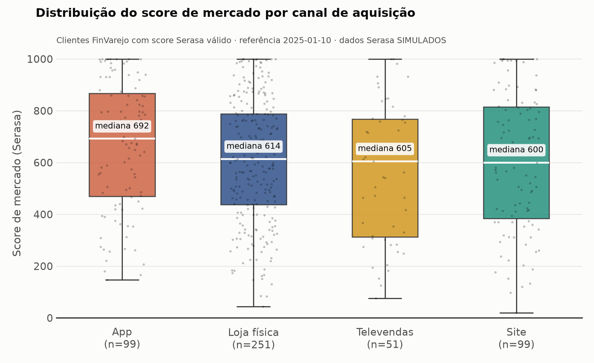

# Teste técnico — Coordenação de Engenharia de Dados (FinVarejo)

Quatro etapas sobre a base FinVarejo, com SQL avançado, dbt, LGPD, Python, Databricks e AWS:

- **Desafio 1 — Qualidade de safras de originação (PDD):** vintage trimestral com CTE recursiva, window functions e pivot.
- **Desafio 2 — Clientes:** público de reativação de cartão (Marketing, com LGPD) e clientes de alto risco (insumo de ML).
- **Desafio 3 — Serasa:** enriquecimento e análise com pandas e seaborn, e arquitetura de feature store no Databricks (AWS).
- **Desafio 4 — CRM:** ingestão batch do export diário (MWAA, Glue, S3, Delta) e tempo real do webhook (Kinesis, Databricks), com ADR.

## Como executar

```bash
# SQL puro (DBeaver, conexão SQLite em FinVarejo.db)
sql/01_safras_inadimplencia_marcos.sql   # Desafio 1 - Tarefa 1
sql/02_ranking_safras_m12.sql            # Desafio 1 - Tarefa 2
sql/03_publico_reativacao_cartao.sql     # Desafio 2 - Item 1
sql/04_clientes_alto_risco.sql           # Desafio 2 - Item 2

# dbt (cria os modelos dentro do próprio FinVarejo.db)
uv venv .venv --python 3.12 && uv pip install --python .venv/Scripts/python.exe dbt-sqlite
cd dbt_finvarejo && ../.venv/Scripts/dbt build --profiles-dir .
```

O `dbt build` cria 8 views (staging e intermediate) e 5 tabelas (marts) e roda 59 testes: **56 passam e 3 geram alertas intencionais**. Os alertas apontam problemas da fonte, descritos em cada desafio: parcelas vencidas ainda `em_aberto`, nenhum disparo de campanha na janela de 6 meses e fontes desatualizadas em relação a hoje. Para aplicar os contratos de dados dos marts num warehouse que os suporta, use `dbt build --vars "{enforce_contracts: true}"`. As quatro queries de `sql/` retornam exatamente o mesmo resultado dos marts.

---

## Desafio 1 — Qualidade de safras de originação (PDD)

### Premissas de negócio

| Tema | Decisão | Motivo |
|---|---|---|
| Safra | Trimestre de `data_contrato` (`AAAA-Tn`) | Conforme enunciado |
| Evento de inadimplência | 1ª parcela, por vencimento, com status `atrasada` ou `baixada` | Conforme enunciado. O `status` do contrato **não** é usado: 917 contratos `ativo` têm parcela atrasada |
| Data do evento | `data_vencimento` dessa parcela | É a data em que o atraso começa |
| Mês de vida | Meses comerciais de 30 dias, com arredondamento para cima: `ceil(dias/30)` | As parcelas vencem exatamente a cada 30 dias, então a parcela N cai no mês N. Com meses de calendário, uma parcela N cairia às vezes no mês N+1 |
| Denominador | Contratos não cancelados da safra | Os 30 cancelados não têm exposição nem atraso |
| Maturação | Marco nulo se `último contrato da safra + N×30 dias > data de referência` | Evita subestimar safras recentes. Hoje todas as safras (2020-T1 a 2023-T4) estão maturadas até o M12 (data de referência: 10/01/2025) |
| Ranking | `RANK()` decrescente: 1 = pior safra do ano | O foco de Risco são as piores safras |
| Média do ano | Média simples das safras, como pede o enunciado. Também entrego a taxa ponderada pelo volume (`pct_m12_ano_ponderado`) | A taxa ponderada é a referência correta para a PDD da carteira |

### Resultado — Tarefa 1 (% acumulado de contratos inadimplentes)

| Safra | Contratos | M03 | M06 | M09 | M12 |
|---|---:|---:|---:|---:|---:|
| 2020-T1 | 99 | 31,31 | 42,42 | 54,55 | 55,56 |
| 2020-T2 | 91 | 34,07 | 50,55 | 56,04 | 60,44 |
| 2020-T3 | 103 | 44,66 | 54,37 | 63,11 | 66,99 |
| 2020-T4 | 99 | 21,21 | 38,38 | 51,52 | 53,54 |
| 2021-T1 | 101 | 36,63 | 51,49 | 52,48 | 54,46 |
| 2021-T2 | 109 | 33,94 | 46,79 | 52,29 | 57,80 |
| 2021-T3 | 110 | 22,73 | 37,27 | 44,55 | 47,27 |
| 2021-T4 | 110 | 30,91 | 46,36 | 51,82 | 57,27 |
| 2022-T1 | 124 | 29,84 | 48,39 | 50,81 | 56,45 |
| 2022-T2 | 100 | 27,00 | 41,00 | 50,00 | 55,00 |
| 2022-T3 | 90 | 38,89 | 43,33 | 47,78 | 55,56 |
| 2022-T4 | 123 | 22,76 | 42,28 | 47,15 | 51,22 |
| 2023-T1 | 90 | 27,78 | 45,56 | 54,44 | 61,11 |
| 2023-T2 | 101 | 26,73 | 43,56 | 48,51 | 52,48 |
| 2023-T3 | 115 | 30,43 | 40,87 | 48,70 | 53,04 |
| 2023-T4 | 100 | 29,00 | 48,00 | 57,00 | 61,00 |

### Resultado — Tarefa 2 (ranking no ano pelo M12)

| Ano | Safra | M12 % | Rank | Média ano | Desvio (p.p.) |
|---|---|---:|---:|---:|---:|
| 2020 | 2020-T3 | 66,99 | 1 | 59,13 | **+7,86** |
| 2020 | 2020-T2 | 60,44 | 2 | 59,13 | +1,31 |
| 2020 | 2020-T1 | 55,56 | 3 | 59,13 | −3,57 |
| 2020 | 2020-T4 | 53,54 | 4 | 59,13 | −5,59 |
| 2021 | 2021-T2 | 57,80 | 1 | 54,20 | +3,60 |
| 2021 | 2021-T4 | 57,27 | 2 | 54,20 | +3,07 |
| 2021 | 2021-T1 | 54,46 | 3 | 54,20 | +0,26 |
| 2021 | 2021-T3 | 47,27 | 4 | 54,20 | **−6,93** |
| 2022 | 2022-T1 | 56,45 | 1 | 54,56 | +1,89 |
| 2022 | 2022-T3 | 55,56 | 2 | 54,56 | +1,00 |
| 2022 | 2022-T2 | 55,00 | 3 | 54,56 | +0,44 |
| 2022 | 2022-T4 | 51,22 | 4 | 54,56 | −3,34 |
| 2023 | 2023-T1 | 61,11 | 1 | 56,91 | +4,20 |
| 2023 | 2023-T4 | 61,00 | 2 | 56,91 | +4,09 |
| 2023 | 2023-T3 | 53,04 | 3 | 56,91 | −3,87 |
| 2023 | 2023-T2 | 52,48 | 4 | 56,91 | −4,43 |

#### Leitura para Risco

- **2020-T3 é a pior safra da série**: já tinha 44,7% de inadimplência no M03 e fechou o M12 7,9 p.p. acima da média do ano. É compatível com a originação no período da pandemia.
- **2021-T3 é a melhor safra**: 47,3% no M12, 6,9 p.p. abaixo da média do ano.
- **2023 voltou a piorar**: média de 56,9% no M12, contra 54,2–54,6% em 2021–2022. As safras T1 e T4 de 2023 ficaram acima de 61%.
- A maior parte da inadimplência acontece até o **M06** (cerca de 80% do valor do M12). Isso indica que a política de originação pesa mais que a deterioração tardia da carteira.

#### Sensibilidade da definição de inadimplência (média do M12 por ano)

A regra do enunciado conta qualquer parcela `atrasada`, a partir de 5 dias de atraso. Para PDD, faz mais sentido usar um corte de dias de atraso, o que já está parametrizado no modelo (`--vars "{dias_atraso_minimo: 90}"`):

| Corte | 2020 | 2021 | 2022 | 2023 |
|---|---:|---:|---:|---:|
| Enunciado (≥5 dias) | 59,1 | 54,2 | 54,6 | 56,9 |
| Over-30 | 54,0 | 47,7 | 49,1 | 50,6 |
| Over-90 | 31,8 | 27,0 | 25,5 | 26,9 |

A definição de evento precisa ser validada com Risco. A IFRS 9 e a Res. CMN 4.966 usam over-90 como referência de default.

#### Alerta de qualidade de dados

5.204 parcelas estão **vencidas há mais de 30 dias, sem pagamento e ainda com status `em_aberto`**. Pela regra atual, elas não contam como inadimplência. Desse total, 213 contratos não têm nenhuma parcela `atrasada` ou `baixada`, então a curva pode estar **subestimada**. O teste `warn_parcelas_vencidas_em_aberto` (severidade `warn`) mostra esse problema a cada execução. A ação recomendada é alinhar com o time do sistema de origem ou mudar a regra para usar `data_vencimento` contra `data_pagamento` em vez do status.

---

### Visão de coordenação

A regra que guiou as escolhas: **cada regra de negócio é escrita uma vez, no lugar certo, e quem consome nunca precisa conhecê-la para usar o número.**

#### 1. Camadas dbt

```
staging/       stg_finvarejo__contrato, stg_finvarejo__parcela           -> view
intermediate/  int_contrato__primeira_inadimplencia                      -> view (ephemeral ou view em prod)
marts/risco/   mrt_risco__curva_safras            (safra × M01..M12)      -> table
               mrt_risco__safras_inadimplencia_marcos   (Tarefa 1)        -> table
               mrt_risco__ranking_safras_m12            (Tarefa 2)        -> table
```

##### Staging: espelho limpo da fonte

- **Grão:** igual ao da fonte, 1 linha por contrato e 1 linha por parcela.
- **O que faz:** tipagem (`date()`, `cast`), padronização de texto (`lower(trim(status))`) e renomeação (`status` vira `status_contrato` e `status_parcela`).
- **O que não faz:** filtro, join ou regra de negócio.
- **Por quê:** se o sistema de origem mudar o formato de data ou mandar um status com espaço, a correção acontece em um lugar só. Os testes de fonte (PK, FK e valores aceitos de status) ficam nesta camada. Eles detectam mudança na fonte antes que ela contamine o resto.

##### Intermediate: a regra de negócio reutilizável

`int_contrato__primeira_inadimplencia`, com grão de 1 linha por contrato elegível, define:

- o que é contrato elegível (exclui cancelados);
- qual é o evento de inadimplência (primeira parcela atrasada ou baixada);
- a safra e o mês de vida de cada contrato.

Essa é a decisão mais importante da arquitetura. Seria mais curto colocar tudo direto no mart, mas a definição de "quando um contrato inadimpliu" não pertence só a esta análise. Ela também serve para:

- modelos de PD e score, que precisam do alvo no nível de contrato;
- cobrança, para saber quando o contrato entrou em atraso;
- comercial, para ver inadimplência por vendedor, loja ou canal.

Se a regra ficar dentro do mart de safras, cada time a reescreve do seu jeito. Em pouco tempo surgem três números de inadimplência diferentes na empresa.

A regra é parametrizada por `vars`: `status_parcela_inadimplente`, `dias_atraso_minimo`, `horizonte_meses` e `data_referencia`. Quando Risco decidir trocar a regra do enunciado por over-90, a mudança é de configuração, não de código, e vale para todos os consumidores ao mesmo tempo.

##### Mart: produto pronto para consumo

Os marts ficam em `marts/risco/`, organizados por domínio de negócio, e não por sistema de origem.

| Modelo | Grão | Papel |
|---|---|---|
| `mrt_risco__curva_safras` | safra × mês de vida (M01–M12) | Base única, no formato longo |
| `mrt_risco__safras_inadimplencia_marcos` | safra | Tarefa 1: pivot dos marcos |
| `mrt_risco__ranking_safras_m12` | safra | Tarefa 2: ranking e desvio |

As Tarefas 1 e 2 são marts porque são agregadas, têm nomes de negócio (`pct_inad_m12`, `desvio_pp_media_ano`), estão documentadas, respondem diretamente a uma pergunta de Risco e são o que o BI consome.

A curva no formato longo é a base dos outros dois marts por três motivos:

- **Consistência:** o M06 da Tarefa 1 e o ponto M06 do gráfico de vintage vêm da mesma linha, então nunca divergem.
- **Flexibilidade:** se Risco pedir M18 ou M24, basta mudar `horizonte_meses`. O formato transposto (marcos como colunas) serve para tabelas e leitura humana; o formato longo é o que o BI precisa para desenhar curvas.
- **Separação de responsabilidades:** a curva calcula, o mart de marcos só reorganiza e o ranking só compara.

Alternativas que descartei:

- **Um único SQL monolítico:** funcionaria, mas não é testável por partes nem reutilizável.
- **`fct_contrato` no mart:** o intermediate já cumpre esse papel. Se outros domínios passarem a consumi-lo diretamente, ele vira `marts/core/fct_contrato_inadimplencia`.

#### 2. Estratégia de materialização

O critério é sempre o mesmo: **quantas vezes o modelo é lido, comparado ao custo de calculá-lo, e com que frequência os dados dele mudam.**

| Camada | Escolha | Justificativa |
|---|---|---|
| Staging | `view` | Transformação leve, quase 1:1 com a fonte. Materializar duplicaria a fonte sem ganho, e a view sempre reflete o dado atual. |
| Intermediate | `view` (local) / `ephemeral` ou `view` (prod) | Ninguém de negócio lê este modelo. Usei `view` porque permite testes (`unique`, `not_null`) e consultas de depuração no DBeaver. `ephemeral` vira CTE e é mais barato, mas não aceita teste nem consulta direta. |
| Marts | `table` | O BI lê muitas vezes ao dia, e o cálculo (window functions sobre cerca de 30 mil parcelas) roda uma vez por carga. O painel abre rápido e todos veem o mesmo número durante o dia. |

##### Evolução em escala: `incremental` por safra

Com o volume atual (16 safras × 12 meses = 192 linhas), recriar a tabela inteira leva menos de 1 segundo e é a opção mais segura. Com milhões de contratos, a estratégia muda e precisa respeitar como uma safra se comporta:

- **Safra em maturação** (originada nos últimos cerca de 13 meses): o número ainda muda todo dia, porque novas parcelas vencem e atrasam.
- **Safra maturada:** M12 fechado; em tese, não muda mais.

Por isso o incremental certo não é "inserir linhas novas", e sim **reescrever apenas as partições das safras que ainda podem mudar**. Exemplo ilustrativo, com partição por data de início da safra:

```sql
{{ config(
    materialized='incremental',
    incremental_strategy='insert_overwrite',   -- ou merge, conforme o warehouse
    partition_by={'field': 'data_inicio_safra', 'data_type': 'date'},
    unique_key=['safra', 'mes_vida']
) }}
...

  where data_contrato >= date('{{ var("data_referencia") }}', '-15 months')  -- janela + margem

```

- A margem acima de 12 meses cobre ajustes retroativos na fonte, como uma parcela que passa de `em_aberto` para `atrasada` com atraso.
- Um `--full-refresh` mensal agendado corrige qualquer desvio que ainda escape.

##### Fechamento contábil da PDD: congelar a curva

A curva de hoje não é a curva que calibrou o fechamento de março, porque a fonte é corrigida e a regra pode mudar. Para auditoria interna, auditoria externa e conformidade com a Res. CMN 4.966, é preciso conseguir responder: "qual curva calibrou a PDD de março?". Há duas formas de garantir isso:

- **`snapshot` dbt** sobre o mart de marcos, com histórico por versão; ou
- **tabela de fechamento** com `data_referencia` na chave, gravada pelo job de fechamento mensal e nunca sobrescrita. É a opção mais simples e explícita.

##### Testes como portão de publicação

O job diário roda `dbt build --select +tag:pdd`. O `build` executa os testes de cada modelo antes de construir os modelos que dependem dele.

**Bloqueiam a publicação** (severidade `error`):
- unicidade da safra e do par safra × mês;
- curva não decrescente (M03 ≤ M06 ≤ M09 ≤ M12);
- percentuais entre 0 e 100.

Se algum falhar, o mart não é atualizado e o painel continua mostrando o número correto de ontem, em vez de um número errado.

**Apenas alerta** (`warn`): `warn_parcelas_vencidas_em_aberto`, um problema conhecido da fonte que não deve parar a operação, mas precisa ficar visível.

#### 3. Exposição para Risco e Financeiro

Três objetivos: **um único número oficial, confiança nesse número e autonomia para quem não escreve SQL.**

##### 3.1 Painel de BI ligado só aos marts

O painel (Power BI, Looker ou Metabase, conforme o padrão da empresa) se conecta apenas aos `mrt_risco__*`. Staging e intermediate não ficam expostos, para que o usuário não técnico não consiga montar a própria definição de inadimplência.

| Visão | Fonte | Para quem / pergunta |
|---|---|---|
| Curva de vintage (uma linha por safra; X = mês de vida, Y = % acumulado) | `curva_safras` | Risco: "as safras novas estão piorando mais rápido que as antigas?" |
| Mapa de calor safra × M03/M06/M09/M12 | `safras_inadimplencia_marcos` | Comitê: visão em uma tela |
| Ranking com semáforo de desvio em p.p. | `ranking_safras_m12` | Financeiro e diretoria: "quais safras pedem mais provisão?" |
| Cabeçalho fixo com a data de referência e as safras em maturação | `fl_maturado` | Todos: evita comparar safra nova com safra madura |

O cabeçalho fixo é o ponto mais subestimado. O erro mais comum na leitura de vintage é concluir que uma safra recente é "boa" quando ela simplesmente ainda não teve tempo de inadimplir. Por isso os marcos não maturados ficam nulos, e não zerados.

##### 3.2 Camada semântica: a métrica definida uma vez

As métricas `pct_inadimplencia_m12`, `desvio_pp_media_ano` e as demais são definidas no dbt Semantic Layer (MetricFlow) ou no modelo semântico do BI. Assim, o Excel conectado do Financeiro, o painel de Risco e a apresentação ao comitê partem da mesma definição.

Isso também resolve a questão da média simples contra a ponderada: as duas existem, com nomes distintos e descrição clara. Sem isso, alguém acaba recalculando a média numa planilha.

##### 3.3 Exposure dbt: rastreabilidade

O `painel_safras_pdd`, em [`_exposures.yml`](dbt_finvarejo/models/marts/risco/_exposures.yml), declara de quais modelos o painel depende e quem é o responsável. Na prática:

- antes de alterar `stg_finvarejo__parcela`, o lineage do `dbt docs` mostra que a mudança afeta o painel de PDD;
- no CI, `dbt build --select state:modified+` testa tudo que depende da alteração, inclusive o que alimenta o painel;
- quando o painel mostra algo estranho, o caminho de investigação já está mapeado.

##### 3.4 Dicionário e glossário em linguagem de negócio

As descrições em português nos `.yml` alimentam o `dbt docs` e o catálogo (DataHub, OpenMetadata ou Purview). Os termos "Safra", "Mês de vida", "M12", "p.p." e "Maturado" ficam definidos num único lugar, junto com a regra escrita por extenso: inadimplência é a primeira parcela atrasada ou baixada, e os cancelados ficam fora do denominador.

O mesmo texto aparece como tooltip no BI, então a pergunta "o que é esse número?" é respondida no próprio painel.

##### 3.5 Governança e confiança

- **Contrato de dados:** em [`_mrt_risco.yml`](dbt_finvarejo/models/marts/risco/_mrt_risco.yml), todos os marts declaram o nome e o tipo (`data_type`) de cada coluna, e o `dbt_project.yml` liga `contract: enforced` por meio de `--vars "{enforce_contracts: true}"`.
  - O dbt então bloqueia o build se o SQL divergir do contrato.
  - Uma mudança incompatível vira nova versão do modelo (`versions:`), e o painel não quebra de surpresa.
  - O padrão local é `false` porque o adapter dbt-sqlite não aplica contracts (só emite "Model contracts cannot be enforced by sqlite!"). Em Snowflake, BigQuery ou Databricks, o contrato é aplicado de fato.
- **Responsável e SLA:** o mart fica atualizado até um horário combinado (por exemplo, 7h em dia útil). Testes que falham geram alerta no canal do time de dados e para o ponto focal de Risco.
- **Acesso por perfil:** os marts são agregados e não contêm dados pessoais (CPF, nome, e-mail), então podem ter acesso amplo em Risco e Financeiro. O detalhe por contrato (intermediate) fica com acesso restrito.
- **Qualidade transparente:** o alerta das parcelas `em_aberto` vencidas aparece no painel como nota. Esconder um problema conhecido custa mais confiança do que mostrá-lo.

##### 3.6 Atender o Financeiro onde ele trabalha

O processo de PDD costuma viver numa planilha de provisionamento. Em vez de exigir que tudo migre para o BI de uma vez:

- extração agendada (CSV ou Excel, ou conexão do Excel ao modelo semântico) do mart de marcos na data de fechamento;
- treinamento curto de leitura de vintage: o que é safra, por que comparar marcos iguais e o que significa o desvio em p.p.

A migração completa para o BI vem depois que o número já for confiável.

#### Resumo

- **Camada:** regra no intermediate, para reuso; análise no mart, organizada por domínio; curva longa como base única.
- **Materialização:** `view` onde é barato e precisa estar sempre atualizado; `table` onde o BI lê muito; `incremental` só nas safras em maturação, quando o volume justificar; `snapshot` para auditoria da PDD; testes como portão de publicação.
- **Exposição:** BI apenas sobre os marts, métrica com uma única definição, lineage via exposure, glossário de negócio, contrato de dados e entrega também no formato que o Financeiro já usa.

---

## Desafio 2 — Clientes: reativação de cartão e alto risco

### Arquitetura dbt adicionada

```
staging/       stg_finvarejo__cliente, __produto_financeiro, __lead_campanha    -> view
intermediate/  int_cliente__indicadores_credito    (1 linha por cliente, sem PII) -> view
               int_cliente__engajamento_campanha   (1 linha por cliente)          -> view
marts/marketing/  mrt_marketing__publico_reativacao_cartao   (Item 1, group marketing) -> table
marts/risco/      mrt_risco__clientes_alto_risco             (Item 2, group risco)     -> table
```

- **Os indicadores de cliente ficam num intermediate compartilhado e sem dados pessoais.** A flag de inadimplência, o atraso recente, o saldo em aberto e a renda frente à mediana servem tanto ao Marketing (para excluir inadimplentes) quanto a Risco e ML. Uma regra única evita que "cliente inadimplente" signifique uma coisa na campanha e outra no modelo de risco.
- **Nome e e-mail só entram nos marts,** e cada mart tem um dono (`groups`: marketing e risco) e metadados LGPD (`meta.lgpd` com finalidade, base legal, retenção e acesso, além de `meta.pii` por coluna).
- **Uma única data de referência (`data_referencia()`) para todos os modelos.** As janelas "últimos 6 meses" e "últimos 90 dias" partem do mesmo corte, e esse corte sai como coluna nos marts, para rastreabilidade.
- **Os critérios do enunciado viram `vars`** (`reativacao_cartao`, `alto_risco`, `regra_inadimplencia_cliente`). Mudar a campanha é configuração, não código.
- **Testes de regra independentes:** `assert_publico_reativacao_regras` e `assert_alto_risco_regras` recalculam os critérios direto nas fontes e falham se algum cliente da lista não deveria estar lá.

### Item 1 — Campanha de reativação de cartão

#### Decisões de design

| Critério | Decisão | Motivo |
|---|---|---|
| Domínio do e-mail | Igualdade no domínio inteiro (`dominio_email in ('gmail.com','yahoo.com.br')`), com e-mail normalizado com `lower(trim())` | `LIKE '%gmail.com%'` aceitaria `gmail.com.br` ou `notgmail.com` |
| Contratos de cartão | `tipo = 'cartao'`, `data_contrato` entre 2021-01-01 e 2023-12-31, **sem cancelados** | Contrato cancelado não foi efetivamente originado |
| Valor médio | Média do `valor_contratado` desses mesmos contratos de cartão | Coerente com o público do critério |
| **"Contrato inadimplente"** | Status `inadimplente` **ou** parcela `baixada` **ou** parcela com mais de 90 dias de atraso, em qualquer produto | O status sozinho é inconsistente (há contratos `ativo` com parcela baixada). Mais de 90 dias é o default regulatório (CMN 4.966). Oferecer cartão a quem tem dívida baixada como perda é risco de crédito e de superendividamento (Lei 14.181) |
| Engajamento | `clicou` ou `contratou` em qualquer campanha, com `data_disparo` nos 6 meses anteriores à data de referência | Conforme enunciado. Quem nunca recebeu campanha é elegível |
| Data de referência | Último pagamento observado (10/01/2025) | É o corte do snapshot. Em produção seria `current_date` |

A definição de inadimplência é a decisão que mais muda o resultado. Por isso ela está parametrizada (`--vars "{regra_inadimplencia_cliente: status}"`):

| Regra de inadimplência | Público (ref. 10/01/2025) | Público (ref. no último disparo, 16/09/2023) |
|---|---:|---:|
| Só status `inadimplente` | 51 | 42 |
| **Status + baixada + mais de 90 dias (adotada)** | **7** | **6** |
| Qualquer parcela atrasada | 0 | 0 |

Partindo dos 65 clientes Gmail/Yahoo com 2 a 3 cartões, a regra adotada exclui 58 por inadimplência.

#### Resultado (7 clientes, dados pessoais mascarados; lista completa no mart)

| id | Nome | E-mail | UF | Canal | Cartões | Valor médio (R$) |
|---:|---|---|---|---|---:|---:|
| 18 | Leonardo A. S. | cl***@gmail.com | SP | loja_fisica | 3 | 4.766,50 |
| 83 | Camila A. O. | ca***@yahoo.com.br | PR | loja_fisica | 3 | 3.085,60 |
| 34 | Larissa S. A. | la***@gmail.com | SC | loja_fisica | 2 | 4.350,52 |
| 5 | Amanda A. F. | cl***@yahoo.com.br | RO | televendas | 2 | 3.459,69 |
| 275 | Paulo B. M. | pa***@gmail.com | SP | app | 2 | 3.020,25 |
| 233 | André A. A. | an***@gmail.com | DF | loja_fisica | 2 | 2.602,49 |
| 1 | Mariana M. F. | cl***@yahoo.com.br | RJ | site | 2 | 1.016,95 |

#### Alertas para Marketing antes do disparo

- **O filtro de 6 meses não exclui ninguém nesta base.** O último disparo registrado em `lead_campanha` é de 16/09/2023, 16 meses antes da data de referência. Pode ser ausência real de campanhas ou carga parada. O teste `warn_campanhas_sem_disparo_na_janela` sinaliza isso a cada execução.
- **E-mails com cara de placeholder:** 18 clientes da base têm e-mail no formato `clienteN@...`, e 3 dos 7 da lista estão nesse caso. É preciso validar antes do disparo, para evitar bounce e prejudicar a reputação do domínio.
- **Não há tabela de opt-out ou consentimento na base.** Isso bloqueia a entrega (ver LGPD abaixo).

#### Medidas de conformidade com a LGPD antes de entregar a lista

1. **Base legal e finalidade:** validar com o DPO a base legal do e-mail marketing (consentimento, ou legítimo interesse com LIA documentado) e registrar o tratamento no ROPA (arts. 7º e 37). A lista serve só a esta campanha.
2. **Opt-out e direitos do titular:** remover descadastrados e clientes sem consentimento antes da entrega. A base não tem essa tabela, o que bloqueia a entrega. Todo e-mail deve ter link de descadastro (art. 18).
3. **Minimização:** só os campos necessários, sem CPF, renda, score ou histórico de crédito. Os dados de crédito servem apenas como filtro de oferta responsável e não saem na lista (art. 6º, III).
4. **Segurança no compartilhamento:** entrega direto na plataforma de e-mail/CRM, com acesso restrito e log, nunca por planilha ou e-mail. Se houver fornecedor (operador), exigir contrato com cláusulas LGPD (arts. 39 e 46).
5. **Retenção:** descartar a lista em até 30 dias após a campanha e manter só os resultados agregados (arts. 15 e 16). Esses termos estão registrados em `meta.lgpd` no mart.

### Item 2 — Clientes de alto risco

#### Decisões de design

| Critério | Decisão | Motivo |
|---|---|---|
| (a) Contratos ativos | `status = 'ativo'`, 2 ou mais | Conforme enunciado. Contratos `inadimplente` não contam como ativos |
| (b) Atraso recente | Parcela com `dias_atraso > 30` e **vencimento** nos 90 dias anteriores à data de referência (de 13/10/2024 a 10/01/2025), em qualquer contrato do cliente | O vencimento é a data em que o atraso começa |
| (c) Renda | `renda_declarada` **estritamente abaixo** da mediana da base de clientes (R$ 6.944,82) | O SQLite não tem `MEDIAN`. A mediana é a média dos valores centrais, calculada com `ROW_NUMBER()` e `COUNT() OVER ()`, e funciona para N par ou ímpar |
| Total em aberto | `valor_parcela − valor_pago` nas parcelas `atrasada` e `em_aberto` de **todos** os contratos do cliente | É o saldo a receber. `baixada` fica de fora porque já é perda reconhecida |

#### Resultado (40 clientes, R$ 1,21 milhão em aberto; top 10 por saldo, nome omitido)

| id | Score | Contratos ativos | Total em aberto (R$) |
|---:|---:|---:|---:|
| 331 | 415 | 4 | 93.253,02 |
| 280 | 638 | 4 | 91.503,50 |
| 307 | 295 | 7 | 81.112,48 |
| 405 | 910 | 7 | 76.554,87 |
| 168 | 944 | 4 | 68.792,25 |
| 259 | 723 | 4 | 67.182,96 |
| 315 | 361 | 4 | 60.008,43 |
| 324 | 475 | 4 | 48.509,97 |
| 95 | 420 | 4 | 44.024,46 |
| 44 | 762 | 4 | 38.977,20 |

**Achado para Data Science:** o `score_interno` não separa esse grupo. O score médio dos 40 clientes de alto risco (603) é **maior** que o da base (586), e 15 deles têm score de 700 ou mais (os ids 405 e 168 têm 910 e 944). É um sinal de que o score atual está mal calibrado para endividamento recente, o que reforça a necessidade do modelo de ML.

#### Qualidade e atualidade dos dados para o time de Data Science

1. **Testes dbt como portão de publicação:**
   - `unique`, `not_null`, `relationships` e `accepted_values` nas fontes e no mart;
   - regras de negócio revalidadas na fonte (`assert_alto_risco_regras`);
   - contrato de colunas e tipos (`contract: enforced`);
   - em produção, monitoramento de volume e de drift de distribuição (Elementary ou dbt-expectations).

   Se um teste falhar, o mart não é publicado.
2. **SLA e atualidade:**
   - freshness das fontes com `error_after` de 24h (localmente, `warn_fontes_desatualizadas`, porque o dbt-sqlite não suporta freshness);
   - mart pronto até 7h em dia útil;
   - `data_referencia` em cada linha e snapshot diário *point-in-time*, para o time de DS reproduzir qualquer base de treino sem vazamento de dados futuros.
3. **Documentação e contrato com o consumidor:**
   - descrição de cada coluna e da regra no `dbt docs`;
   - exposure `modelo_ml_risco_cliente`, com dono, para o lineage mostrar o impacto de qualquer mudança;
   - mudança de regra publicada como nova versão do modelo;
   - para treino, `id_cliente` pseudonimizado e sem `nome`. Uma decisão automatizada de crédito também exige explicabilidade e direito de revisão (LGPD, art. 20).

---

## Desafio 3 — Enriquecimento Serasa e feature store (Python + Databricks/AWS)

> **Dados do Serasa simulados.** O CSV real não foi disponibilizado. [`python/gerar_serasa_simulado.py`](python/gerar_serasa_simulado.py) gera três arquivos diários (08 a 10/01/2025) com o layout informado, semente fixa e problemas típicos de um feed externo: CPF com e sem máscara, CPFs fora da base, linhas duplicadas, score vazio ou fora da escala e variações de grafia como `ALTA` e `Média`. O pipeline lê qualquer `serasa_score_*.csv`, então basta trocar a pasta pelos arquivos reais. **As conclusões de região e canal abaixo são artefato da simulação; refazer com o arquivo real.**

```bash
.venv/Scripts/python python/gerar_serasa_simulado.py FinVarejo.db data/serasa   # só sem o arquivo real
.venv/Scripts/python python/enriquecimento_serasa.py FinVarejo.db data/serasa output
```

As saídas ficam em `output/`: top 10 em CSV, top 3 regiões em CSV, relatório de qualidade e o gráfico em PNG. O top 10 contém nomes, então `output/` é local e não deve ser versionada.

### Item 1 — Enriquecimento e análise

#### Decisões de design

| Tema | Decisão | Motivo |
|---|---|---|
| Chave de join | CPF **só com dígitos, com zeros à esquerda até 11** dos dois lados | O FinVarejo grava `000.000.000-20` e o Serasa manda `00000000020`. Sem normalizar, o join não casa nenhuma linha. Não validei o dígito verificador porque os CPFs da base são fictícios e falhariam todos |
| Qualidade do feed | Remover duplicatas exatas, scores vazios ou fora de 0–1000 e CPFs com mais de 11 dígitos; normalizar a propensão (sem acento, primeira maiúscula) | O feed externo não é confiável. Cada descarte é contado num relatório de qualidade |
| Visão atual | Último `data_referencia` disponível por CPF | 25 clientes não vieram no arquivo de hoje e usam o score do dia anterior; isso fica registrado. O histórico completo fica na Silver (Item 2) |
| Upgrade de limite | `score_mercado − score_interno > 0`, **excluindo quem tem contrato inadimplente ou atraso acima de 30 dias nos últimos 90 dias** (indicadores do dbt) | Sem esse filtro, **8 dos 10 primeiros** eram clientes com inadimplência interna, que o score de mercado não enxerga. Um deles estava na lista de alto risco do Desafio 2 |
| Escalas | Comparação direta, como pede o enunciado | O score interno vai de 200 a 950 e o Serasa de 0 a 1000. Em produção, eu compararia percentis ou calibraria as duas escalas antes |
| Região | UF → região pela dimensão `loja` (19 UFs, cobertura total, com falha explícita se surgir UF sem região) | O cliente só tem UF. Usar a dimensão existente evita uma segunda tabela de-para |
| Concentração | **% de clientes da região com propensão Alta**, com o número absoluto ao lado | "Concentração" é proporção. Por contagem absoluta, a região com mais clientes ganharia sempre |

**Qualidade do feed (3 arquivos):** 1.497 linhas recebidas, 12 duplicadas removidas, 15 scores inválidos descartados, 15 CPFs fora da base e 100% dos 500 clientes enriquecidos.

#### Top 10 candidatos a upgrade de limite (nomes mascarados; lista completa em `output/`)

| # | Cliente | Score interno | Score mercado | Diferença | Canal |
|---:|---|---:|---:|---:|---|
| 1 | Thiago S. A. | 322 | 762 | +440 | Loja física |
| 2 | Beatriz A. M. | 514 | 786 | +272 | App |
| 3 | Amanda L. O. | 512 | 765 | +253 | Site |
| 4 | Daniela O. V. | 652 | 877 | +225 | Loja física |
| 5 | Ana M. B. | 427 | 637 | +210 | Site |
| 6 | Leonardo F. O. | 397 | 600 | +203 | Site |
| 7 | Henrique C. F. | 606 | 803 | +197 | Site |
| 8 | Patrícia P. L. | 691 | 886 | +195 | Loja física |
| 9 | Aline S. S. | 295 | 483 | +188 | Loja física |
| 10 | Amanda S. A. | 610 | 797 | +187 | App |

#### Top 3 regiões por concentração de propensão Alta

| Região | Clientes | Propensão Alta | % Alta |
|---|---:|---:|---:|
| Nordeste | 136 | 79 | 58,1% |
| Norte | 72 | 40 | 55,6% |
| Centro-Oeste | 72 | 36 | 50,0% |

#### Distribuição do score de mercado por canal



- **Boxplot com os pontos individuais sobrepostos:** com n entre 51 e 251 por canal, o boxplot sozinho esconderia o volume. Cada canal mostra o n no rótulo e a mediana anotada, e os canais estão ordenados pela mediana.
- **Paleta da marca:** definida em [`python/brand.py`](python/brand.py), com uma cor fixa por canal, que se mantém em qualquer gráfico e ordem. Validei a paleta para daltonismo: a menor diferença perceptível entre cores vizinhas é 12,4 em deuteranopia (mínimo recomendado: 8).
- **Contraste do âmbar:** ele fica abaixo de 3:1 contra o fundo; por isso os rótulos de cada canal são visíveis e não dependem só da cor.
- **Ajuste à marca oficial:** a paleta da FinVarejo não foi informada. Para usar a oficial, basta trocar os hex em `brand.py`.

### Item 2 — Arquitetura de feature store no Databricks (AWS)

Os arquivos estão em [`databricks/`](databricks/), como um Databricks Asset Bundle: o job diário, o pipeline e os notebooks. Não havia workspace disponível, então o código foi validado apenas quanto à sintaxe (Python e YAML) e não foi executado.

#### Camadas Bronze, Silver e Gold no S3 com Delta Lake

| Camada | Conteúdo | Implementação |
|---|---|---|
| **Landing** | CSV do Serasa como chegou, via SFTP gerenciado (AWS Transfer Family) para S3 | Lifecycle S3: apaga em 30 dias. O Bronze já guarda o conteúdo |
| **Bronze** | Tudo como string, append-only, com `_arquivo`, `_ingerido_em` e `_rescued_data` | Auto Loader ([`pipeline_serasa.py`](databricks/src/pipeline_serasa.py)). Mudanças de layout vão para `_rescued_data` em vez de quebrar a carga. **É o único lugar com CPF em claro**, com acesso só do service principal de ingestão e retenção de 90 dias |
| **Silver** | Tipado, validado, CPF tokenizado (`sha2(cpf + pepper)`, com o pepper no secret scope) e deduplicado. Guarda **todas as versões**: 1 linha por `cpf_token × data_referencia × disponivel_em` | Expectations do Lakeflow: descarta linha com CPF, score ou data inválidos e só alerta para propensão fora do domínio ou coluna nova. As métricas de cada regra ficam no event log do pipeline |
| **Gold** | `features_cliente_serasa`: features prontas, com chave `(id_cliente, ts_feature)` e sem CPF | Tabela Delta **externa** em `s3://finvarejo-lakehouse-<env>/gold/`, com `PRIMARY KEY (id_cliente, ts_feature TIMESERIES)`: no Unity Catalog, isso a torna uma feature table de série temporal ([`gold_feature_table.py`](databricks/src/gold_feature_table.py)). A carga é por `MERGE`, então reprocessar não duplica |

#### Point-in-time correctness (evitar data leakage)

1. **O instante da feature é quando o dado chegou, não a `data_referencia`.** `ts_feature = disponivel_em`, o momento da ingestão. Um arquivo com referência D que chega em D+1 06:00 não pode alimentar uma decisão tomada em D 18:00.
2. **A Silver guarda histórico append-only, sem sobrescrever.** Se o Serasa reenviar uma data corrigida, ela entra como nova versão, com outro `disponivel_em`. O treino reproduz exatamente o que se sabia em cada data.
3. **Atributos internos também precisam ser point-in-time.** Usar o `score_interno` atual para rotular decisões de 2023 é vazamento. A Gold faz um *as-of join* com o histórico SCD2 do cliente (via CDC), usando o registro vigente em `ts_feature`. Features derivadas, como a variação do score, usam só observações anteriores (`lag`).
4. **No treino:** `FeatureLookup(timestamp_lookup_key="data_observacao", lookback_window=7 dias)` faz o as-of join por rótulo e devolve nulo quando o score é velho demais, em vez de usar um valor antigo ([`exemplo_treino_point_in_time.py`](databricks/src/exemplo_treino_point_in_time.py)). O modelo é registrado com `fe.log_model`, e a inferência busca as features pela mesma lógica, sem diferença entre treino e produção.

#### Registro no AWS Glue Data Catalog

- **Dois catálogos, cada um com seu papel:**
  - O **Unity Catalog** é a fonte de verdade de governança dentro do Databricks: permissões, lineage e feature tables.
  - O **Glue Data Catalog** atende os consumidores nativos da AWS: Athena, SageMaker e QuickSight.
- **Os dois apontam para o mesmo caminho Delta no S3, sem cópia.** O job registra a Gold no Glue com uma DDL do Athena (`CREATE EXTERNAL TABLE ... TBLPROPERTIES ('table_type'='DELTA')`, em [`registrar_glue.py`](databricks/src/registrar_glue.py)). O schema é lido do `_delta_log`, então mudanças compatíveis não exigem novo registro.
- **Permissões no Glue:** via **Lake Formation**, somente leitura e por grupo. O Bronze, que tem CPF, **não** é registrado no Glue.
- **Alternativa para workspace sem Unity Catalog:** usar o Glue diretamente como metastore (`spark.databricks.hive.metastore.glueCatalog.enabled=true`). É o modo legado; eu só usaria em migração.

#### SLA de atualização

| Etapa | Compromisso | Como é garantido |
|---|---|---|
| Chegada do arquivo Serasa | D0 até **06:00** BRT (contrato com o Serasa) | Alerta às 06:30 se não houver arquivo novo na landing (SQL alert sobre o Bronze) |
| Bronze → Silver → Gold → Glue | Feature table publicada até **07:30** BRT | Job disparado pela chegada do arquivo ([`databricks.yml`](databricks/databricks.yml)); alerta se passar de 45 min; e-mail em falha; `max_concurrent_runs: 1` |
| Portão de qualidade | Não publica dado ruim | Expectations na Silver. Na Gold, falha se não houver carga do dia ou se o volume cair mais de 10% contra ontem |
| Recuperação | Reprocessar qualquer dia | Bronze imutável, `MERGE` idempotente e time travel do Delta |
| Monitoramento | Drift e atualidade das features | Lakehouse Monitoring na Gold (distribuição do `score_mercado` e % de nulos), com painel de SLA compartilhado com Data Science |

**LGPD no feed Serasa:**
- **CPF tokenizado já na Silver:** o join com o cliente usa o mesmo token, e as features ficam por `id_cliente`.
- **Uso limitado ao contrato:** o dado do Serasa só pode ser usado na finalidade contratada (crédito). Isso fica documentado nas propriedades da tabela.
- **Bronze:** acesso restrito e retenção curta.

#### Feature store ou view no Databricks?

Eu responderia ao cientista de dados assim:

1. **View basta** quando o modelo só precisa do valor de *hoje* (exploração, protótipo, lista de upgrade do dia): é recalculada a cada consulta, não tem custo de manutenção e sempre traz o dado mais recente.
2. **Feature store é necessária** quando o modelo treina com histórico. A view mostra só o valor atual; usada para rotular decisões de 2023, ela traz o score de 2025 e vaza o futuro. A feature table guarda cada valor com a data em que chegou e busca o valor "daquela data".
3. **Treino e produção iguais:** o modelo registrado com a feature store busca as features da mesma forma no treino e na inferência. Com view, cada lado reimplementa a lógica, e o modelo piora em produção sem ninguém perceber.
4. **Reuso e governança:** a feature é calculada uma vez, com dono, SLA, testes e rastreabilidade até o modelo, e serve a vários modelos (PD, limite, cobrança). Com views, cada time cria a sua versão do "score de mercado".
5. **Regra:** se o modelo vai para produção ou treina com histórico, use feature store; se é análise pontual do estado atual, use view. O custo extra só se justifica quando há histórico ou reuso.

<details>
<summary>Por trás de cada linha (caso o cientista insista)</summary>

- **Linhas 1 e 2 — o exemplo concreto.** Um cliente teve score Serasa 450 em mar/2023, quando pediu crédito e depois inadimpliu. Hoje o score dele é 800.
  - **Com view:** o treino associa "inadimpliu" a "score 800". O modelo aprende uma relação falsa, vai bem na validação e mal em produção.
  - **Com a feature table:** a busca com `timestamp_lookup_key` devolve o 450, o valor disponível no dia da decisão.
- **Linha 3 — onde os problemas costumam aparecer.** No treino, o cientista usa um notebook com a view; em produção, a engenharia reescreve a lógica num job. Uma diferença pequena, como outra regra de duplicatas ou outro fuso, muda a distribuição das features. O `fe.log_model` com `score_batch` usa a mesma definição nas duas pontas.
- **Linha 4 — custo organizacional.** Sem um lugar central, o "score de mercado" passa a existir em três versões, com regras de limpeza diferentes, e ninguém sabe qual modelo usa qual.
- **Linha 5 — a feature store também tem custo.** Ela exige pipeline, armazenamento do histórico e SLA. Para uma pergunta pontual sobre o estado atual, uma view resolve e é a escolha certa.

</details>

---

## Desafio 4 — Ingestão do CRM: batch (Export) e tempo real (Webhook)

> **O que foi validado.** Não houve acesso a uma conta AWS nem a um workspace Databricks, então nada foi implantado. Validei localmente:
> - **12 testes unitários** (`pytest aws/tests`): assinatura HMAC (inclusive replay e adulteração), chave de deduplicação estável, **paridade do `event_id` entre a Lambda e o Databricks** e classificação por criticidade;
> - **`cfn-lint`** do template CloudFormation, sem avisos;
> - sintaxe de todos os `.py` e `.yml`.
>
> As APIs do CRM (endpoint de export, `Idempotency-Key`, formato do aviso) são **premissas** e estão marcadas no código.

```bash
.venv/Scripts/python -m pytest aws/tests                          # 12 testes
.venv/Scripts/cfn-lint -t aws/infra/ingestao_crm.yaml --regions sa-east-1
```

| Peça | Arquivo |
|---|---|
| Orquestração (MWAA) | [`aws/mwaa/dags/crm_export_raw_diario.py`](aws/mwaa/dags/crm_export_raw_diario.py) |
| Webhook "export pronto" | [`aws/lambda/crm_webhook_export/handler.py`](aws/lambda/crm_webhook_export/handler.py) |
| Webhook Data Stream → Kinesis/Firehose | [`aws/lambda/crm_webhook_stream/handler.py`](aws/lambda/crm_webhook_stream/handler.py) |
| Lógica compartilhada e testada | [`aws/lambda/comum/crm_eventos.py`](aws/lambda/comum/crm_eventos.py), [`aws/tests/`](aws/tests/) |
| Mapa de criticidade | [`aws/config/criticidade_eventos.json`](aws/config/criticidade_eventos.json) |
| Cópia dos 2 TB (Glue) | [`aws/glue/copiar_export_crm.py`](aws/glue/copiar_export_crm.py) |
| Infra, alarmes e orçamento | [`aws/infra/ingestao_crm.yaml`](aws/infra/ingestao_crm.yaml) |
| Batch Bronze/Silver | [`databricks/src/crm_export_bronze_silver.py`](databricks/src/crm_export_bronze_silver.py) |
| Streaming Kinesis | [`databricks/src/crm_stream_kinesis.py`](databricks/src/crm_stream_kinesis.py) |
| MERGE de deduplicação (único) | [`databricks/src/crm_comum.py`](databricks/src/crm_comum.py) |
| Lakehouse Monitoring e alertas | [`databricks/src/crm_monitoramento.py`](databricks/src/crm_monitoramento.py) |
| Jobs Databricks | [`databricks/resources/crm.yml`](databricks/resources/crm.yml) |
| Decisão arquitetural | [`docs/adr/ADR-001-ingestao-crm-batch-e-streaming.md`](docs/adr/ADR-001-ingestao-crm-batch-e-streaming.md) |

### Item 1 — Pipeline batch do Export Raw User Data

#### (1) Agendamento confiável na janela UTC, falhas e idempotência

- **Horário:** a DAG roda às **00:15 UTC**, logo após a virada da janela. Isso deixa cerca de 23h de folga para falhas e reprocesso no mesmo dia, e o export cobre o dia D-1 UTC inteiro.
- **Estado fora do Airflow:** a DAG mantém uma máquina de estados numa tabela DynamoDB (`crm_export_controle`, chave `export_date`), com os estados `RESERVED → REQUESTED → READY → COPIED → LOADED`. Cada passo lê o estado e **pula o que já foi feito**. Reexecutar a DAG, rodar backfill ou fazer clear de tarefas nunca repete efeito colateral.

Tratamento de cada falha:

| Situação | Tratamento |
|---|---|
| Duas execuções simultâneas ou reexecução | `put_item` condicional (`attribute_not_exists`) funciona como trava; `max_active_runs=1` |
| 5xx ou timeout ao pedir o export | Retry com backoff exponencial **com a mesma `Idempotency-Key`**: o CRM devolve o mesmo `request_id` e não consome a cota de novo |
| 429 (cota do dia já usada sem `request_id` nosso) | `AirflowFailException` sem retry, estado `QUOTA_EXHAUSTED` e alerta para o plantão. Não há como pedir de novo hoje; os eventos críticos do dia estão cobertos pelo webhook |
| Aviso "pronto" repetido, atrasado ou de outro request | A Lambda só transita `REQUESTED → READY` para o `request_id` que nós pedimos (update condicional); o resto é ignorado com 200 |
| Aviso não chega | Sensor em `mode="reschedule"` (não prende worker) por até 18h. Alarme no CloudWatch se a latência passar de 8h |
| Link perto de expirar | `verificar_prazo_link` publica as horas restantes. Com menos de 3h, falha rápido, porque 2 TB não cabem com segurança. Alarme com menos de 6h |
| Cópia cai no meio dos 2 TB | O job Glue é **retomável**: a chave de destino é determinística e arquivos já presentes com o mesmo tamanho são pulados. O retry só copia o que faltou |
| Arquivo corrompido | sha256 conferido durante o streaming (quando o manifesto traz) e contagem e tamanho conferidos contra o manifesto em `validar_copia`. Só então é gravado o `_SUCCESS` |
| Carga no Databricks falha | Retry seguro: a Bronze usa `replaceWhere export_date = X` (sobrescreve só o dia) e a Silver usa MERGE por `event_id` |
| MWAA indisponível | Os alarmes ficam no CloudWatch, fora do orquestrador. Se a DAG não rodar, a ausência da métrica `ExportConcluido` dispara o alerta |

#### (2) Estratégia para 2 TB: formato, particionamento e compressão

| Zona | Formato e compressão | Layout | Por quê |
|---|---|---|---|
| **Raw S3** | Como o CRM entregou (JSON Lines `.gz`) | `export_raw/export_date=AAAA-MM-DD/`, versionado, Object Lock (governance, 30 dias), Glacier Instant Retrieval após 30 dias | Prova imutável do que foi recebido; reprocesso sem depender do link |
| **Bronze** Delta | Parquet **ZSTD** (cerca de 5–7x menor que JSON: 2 TB viram aproximadamente 300–400 GB) | `PARTITIONED BY (export_date)`, arquivos de ~512 MB (`optimizeWrite`/`autoCompact`) | Uma partição grande por dia, sem small files; `replaceWhere` torna a carga idempotente; retenção por partição |
| **Silver** Delta | Parquet ZSTD, Change Data Feed ligado | **Liquid clustering** `(event_date, user_id)` | MERGE por `event_id` com data skipping; sem skew de partição por tipo de evento; as chaves podem mudar sem reescrever a tabela |

Pontos de vazão:

- **Cópia:**
  - quando o link é `s3://` (cross-account), a cópia é **server-side** (`UploadPartCopy`): nenhum byte passa pelo job;
  - quando é HTTPS pré-assinado, é feita em streaming com multipart de 128 MB, um arquivo por task do Spark, começando pelos maiores;
  - meta: 2 TB em até 3h, o que exige cerca de 190 MB/s agregados. Com 30–40 arquivos em paralelo, isso fica bem dentro da folga de 24h.
- **gzip não é divisível:** um `.json.gz` de 50 GB vira uma única task de horas. O contrato com o CRM pede arquivos de no máximo ~1 GB; se vierem maiores, a cópia os re-particiona.
- **Cluster do batch:**
  - instâncias `i4i`, com NVMe local para o shuffle do MERGE;
  - autoscale de 8 a 40 nós;
  - **spot com fallback**, porque a reexecução é idempotente. O streaming roda on-demand.
- **Glue Data Catalog:** a raw é registrada com *partition projection* em `export_date` (Athena sem crawler); a Gold, como no Desafio 3.

#### (3) SLA e monitoramento

| Marco (UTC) | SLA | Alarme |
|---|---|---|
| Pedido do export | até 00:30 | Falha da task → SNS |
| Aviso "pronto" do CRM | até 08:00 (ajustar ao P95 histórico) | `ExportLatenciaWebhookMin` > 480 |
| Cópia íntegra no S3 | até 3h após o aviso **e** pelo menos 6h antes de o link expirar | `ExportLinkHorasRestantes` < 6 |
| Bronze + Silver | até 3h após a cópia | Health rule do job Databricks (> 3h) |
| **Dados do dia disponíveis** | **12:00 UTC (09:00 BRT) em 99% dos dias**, com 100% das linhas do manifesto | `ExportConcluido` ausente em 24h; alerta SQL `crm_batch_atrasado` |

- **CloudWatch** (infraestrutura e orquestração):
  - métricas próprias no namespace `FinVarejo/CRM`: pedido, latência do aviso, horas de link restantes, GB copiados, duração total e eventos por rota;
  - métricas nativas de Lambda, API Gateway, Kinesis e MWAA;
  - alarmes → SNS → plantão;
  - um dashboard único com a linha do tempo do dia.
- **Databricks Lakehouse Monitoring** (dado, não infraestrutura):
  - monitor de série temporal na Silver (`event_ts`, janelas de 1h e 1 dia), com **fatias por `event_type` e por `_origem`**;
  - métricas próprias: `% sem user_id` e atraso médio de ingestão;
  - as tabelas de perfil e drift alimentam alertas SQL de volume anômalo (menos de 70% da média de 7 dias por tipo), drift (distância JS > 0,2), atualidade do tempo real (nada há 15 min) e **reconciliação** (webhook com menos de 99% dos eventos críticos do export).

### Item 2 — Integração em tempo real com Kinesis Data Streams

#### Separação por criticidade

| Rota | Eventos | Destino | Latência alvo | Por quê |
|---|---|---|---|---|
| **Realtime** | `pagamento`, `compra`, `alteracao_cadastral`, `login`, `opt_out`, `consentimento` | Kinesis Data Streams → antifraude (enhanced fan-out) e Databricks streaming | p95 < 2 s até o antifraude; < 2 min até a Silver | Fraude e tomada de conta acontecem em minutos; opt-out precisa parar disparos já (LGPD) |
| **Batch** | SMS/push/e-mail enviados, entregues, abertos e clicados; navegação; atributos não sensíveis | Firehose → S3 (sem shard-hours); a fonte oficial é o export diário | D+1 | Engajamento não muda decisão em segundos |

- **Configuração:** o mapa é versionado ([`criticidade_eventos.json`](aws/config/criticidade_eventos.json)) e publicado no AppConfig; mudar a rota não exige deploy.
- **Tipos desconhecidos:** vão para batch (o export garante a completude) e geram a métrica `EventoTipoDesconhecido`, com alarme.
- **Partition key `user_id`:** preserva a ordem dos eventos de um mesmo cliente dentro do shard, que é a sequência que o antifraude analisa, e distribui a carga de forma uniforme.

#### Deduplicação no Delta Lake

A entrega é at-least-once em toda a cadeia: o CRM reenvia, a Lambda retenta o `PutRecords` parcial e a leitura do Kinesis pode repetir. Por isso a deduplicação é feita em camadas:

1. **Uma chave única para as duas origens:** usa o `event_id` nativo do CRM. Na falta dele, um hash SHA-256 do conteúdo canônico (`user_id`, tipo, `event_ts`, propriedades, com chaves ordenadas). A **mesma função** roda na Lambda e no Databricks, e um teste de paridade garante isso.
2. **Bronze do stream:** escrita idempotente no `foreachBatch` (`txnAppId` + `txnVersion = batch_id`). Reprocessar um micro-batch após falha não duplica.
3. **Dentro do lote:** `row_number()` por `event_id`; o export tem prioridade sobre o webhook e, em seguida, vale o mais recente.
4. **Contra a Silver:** `MERGE ... ON t.event_date IN (<datas do lote>) AND t.event_date = s.event_date AND t.event_id = s.event_id`. A data no `ON` limita a varredura aos arquivos daquelas datas (clustering), em vez da tabela inteira a cada 30 s.
   - **Evento novo:** `INSERT`.
   - **Já veio pelo webhook e agora chega pelo export:** `UPDATE` com a versão autoritativa, preservando `_visto_webhook_em`.
   - **Qualquer outra repetição:** não altera nada.
5. **Reconciliação:** a tabela `ops.crm_reconciliacao` mede, por tipo crítico, a % dos eventos do export que o webhook já tinha entregado. É o indicador de perda do tempo real.

#### Controle de custo (shard-hours)

- **Só o crítico entra no Kinesis**, cerca de 10–20% do volume do webhook. O resto vai pelo Firehose, cobrado por GB, sem shard-hour.
- **Dimensionamento:**
  - fórmula: `shards = max(pico MB/s ÷ 1, pico registros/s ÷ 1000) × 1,3`;
  - começar em **on-demand** por cerca de 30 dias, para medir o pico real;
  - depois, passar para **provisioned**, mais barato com tráfego previsível;
  - escalar com `UpdateShardCount` acionado pelo alarme de uso acima de 70% (ou agendado para picos conhecidos, como Black Friday).
- **Retenção de 24h**, o padrão. A retenção estendida é cobrada por shard-hour adicional, e a cópia de longo prazo é a Bronze Delta.
- **Enhanced fan-out só para o antifraude:** é cobrado por consumidor-shard-hora. O Databricks lê pelo modo compartilhado.
- **`PutRecords` em lote** (até 500 registros), reduzindo chamadas e custo de PUT payload units.
- **Guarda-corpos:**
  - AWS Budget do Kinesis com alerta em 80% do previsto;
  - alarmes de throttling e de uso acima de 70%;
  - o cluster de streaming é pequeno (2 nós on-demand) e é o principal custo do lado Databricks.

#### Vale manter dois pipelines? (argumento em 6 linhas)

1. **Cada pipeline cumpre uma obrigação diferente:** o webhook dá **tempestividade** e o export dá **completude e trilha reprocessável**. Nenhum faz as duas coisas.
2. **Regulatório:** prevenção a fraudes (Res. Conjunta BCB/CMN nº 6/2023) e PLD/FT (Circular BCB nº 3.978/2020) exigem detectar e agir em tempo hábil, o que D+1 não atende. A Res. CMN nº 4.893/2021 e a auditoria exigem rastreabilidade, e um stream sem replay não garante isso.
3. **Negócio:** uma única fraude de tomada de conta evitada costuma pagar meses de Kinesis, porque o tempo real cobre só os 10–20% de eventos críticos. Os outros 80–90% ficam no batch, que custa pouco.
4. **Ter só um pipeline sai caro dos dois lados:** só streaming significa pagar tempo real para 100% do volume e ainda não ter garantia de que nada se perdeu; só batch significa fraude descoberta depois do prejuízo e opt-out desrespeitado por até um dia.
5. **A complexidade é contida:** os dois pipelines compartilham uma única Silver, a mesma chave, o mesmo MERGE e o mesmo monitoramento. A reconciliação diária transforma a redundância em controle automático de qualidade.
6. **A decisão é reversível:** desligar o streaming não perde nenhum dado, só a latência. O risco de manter é baixo, e o de não ter é regulatório e financeiro.

### Como coordenador: documentar a decisão (ADR) e tornar os trade-offs explícitos

**Onde e como.** O ADR fica em [`docs/adr/ADR-001-ingestao-crm-batch-e-streaming.md`](docs/adr/ADR-001-ingestao-crm-batch-e-streaming.md), versionado junto com o código. Uma mudança de arquitetura entra no mesmo PR que o ADR e passa pelo fórum de arquitetura. O formato é Nygard/MADR:
- status;
- decisores, consultados e informados;
- contexto, decisão e alternativas descartadas;
- trade-offs, consequências e **gatilhos de revisão** (as condições objetivas para reabrir a decisão).

**Para o squad (técnico):**
- o ADR completo, com o diagrama, a lista de alternativas e o motivo de cada descarte, os SLOs e o plano de reversão;
- links para o código e para os alarmes que materializam cada decisão;
- a cada mudança relevante, um novo ADR que **substitui** o anterior, sem editar o original, para o histórico continuar legível.

**Para quem não é técnico** (Fraude, Risco, Financeiro, Compliance, diretoria):
- o **resumo executivo** no topo do mesmo documento, em uma página e sem jargão;
- o resumo responde: qual era o problema, o que decidimos, por que não a alternativa mais simples, quanto custa, qual risco aceitamos e o que muda para cada área;
- é apresentado no comitê com uma tabela "se usarmos só X → consequência";
- o aceite das áreas consultadas fica registrado no próprio ADR, porque Compliance e Fraude são corresponsáveis pela decisão.

**Trade-offs que eu tornaria explícitos** (tabela completa no ADR):

| Ganhamos | Pagamos |
|---|---|
| Fraude e opt-out em segundos | Mais um pipeline para operar (plantão, deploy, monitoramento) |
| Completude e auditoria pelo export | **Consistência eventual**: até D+1, o dado do webhook é provisório |
| Custo de streaming limitado ao crítico | Governança contínua da lista de criticidade |
| Uma Silver, sem "duas verdades" | Acoplamento: os dois caminhos dependem do mesmo schema e da mesma deduplicação |
| Reprocesso de qualquer dia | **Duas cópias de dados pessoais**, o que aumenta a superfície LGPD (mitigada com retenção curta e acesso restrito) |
| Stack AWS + Databricks já adotada | Dependência de dois fornecedores e custo de saída |

Também registraria o **custo de não decidir**: manter só o batch é uma aceitação implícita de risco de fraude e de não conformidade. Isso precisa constar no documento, e não ficar implícito.
